<div align="center">



<br/>

[](https://wakatime.com/@018e1d14-e724-421b-829a-f36c5ce56b98)


</div>

---



Hi, I'm **Jérémy**, aka **Swaiku**. Bachelor in Data Engineering at **HEIA-FR**, now a **Master's student in Data Science at HES-SO**.

I like building things that move, learn and stay honest about your data: robots, ML pipelines and self-hosted infrastructure, all with a strong preference for open source and privacy.

```text
┌─────────────────────── TELEMETRY ───────────────────────┐
│ OPERATOR      : Swaiku (Jérémy)                         │
│ BASE          : Fribourg, Switzerland                   │
│ TRAINING      : MSc Data Science, HES-SO                │
│ PREVIOUS      : BSc Data Engineering, HEIA-FR           │
│ FLIGHT HISTORY: Eurobot robotics competition (alumni)   │
│ GROUND STATION: Raspberry Pi 5 homelab                  │
│ OS            : Linux                                   │
│ CONDITIONING  : Running, archery                        │
│ PRIORITIES    : Space, Robotics, Privacy, Open Source   │
└─────────────────────────────────────────────────────────┘
```

---


**Flight software**


**Onboard systems**


**Data & ground segment**


**Mission dashboards**


---


| Mission | Objective | Status |
|---|---|---|
| **Master's program** | MLOps, cloud systems, new data technologies | `IN PROGRESS` |
| **UAV research** | Autonomous navigation for UAVs | `IN PROGRESS` |
| **Homelab** | Self-hosted stack on Raspberry Pi 5 | `ONLINE` |
| **Archery club** | Website and media for my local club | `MAINTAINED` |
| **Running** | Building endurance, one run at a time | `IN PROGRESS` |

---


<div align="center">


</div>

---


- Passion projects
- Experiments with cutting-edge tech
- Tooling and self-hosted setups

<div align="center">

<br/>

```text
>> END OF TRANSMISSION. Thanks for stopping by, and happy coding.
```

</div>
